# 🔐 The Data Vault: Dutch Banking Expedition

An interactive, gamified mobile-first browser game built for the client visit to our **Enterprise Data & Analytics** department (Netherlands Banking Domain).

Clients play on their smartphones as they tour the department: solving puzzles to discover each team, visiting their presentations, collecting secret lock digits, and ultimately cracking a **physical 4-digit combination safe box** filled with authentic Dutch souvenirs (Stroopwafels, Dutch Gouda, banking gifts).

---

## 🎯 Game Flow & Rules

```mermaid
flowchart TD
    Start["📱 Welcome Screen<br/>(Client Briefing & Rules)"] --> P1["🧩 Puzzle 1: Pipeline Router<br/>(Rotate pipes to stream transactions)"]
    P1 --> T1["🏢 Team 1 Revealed:<br/>Data Platform & Cloud Engineering"]
    T1 --> Pres1["👥 Visit Room 'Van Gogh'<br/>(Client attends Presentation)"]
    Pres1 --> Code1["🔑 Enter Presenter Word: 'LAKEHOUSE'<br/><b>🎉 DIGIT #1 REVEALED: [ 7 ]</b>"]

    Code1 --> P2["🧩 Puzzle 2: Anomaly Hunter<br/>(Tap 4 corrupted banking records)"]
    P2 --> T2["🏢 Team 2 Revealed:<br/>Data Quality & Observability"]
    T2 --> Pres2["👥 Visit Room 'Rembrandt'<br/>(Client attends Presentation)"]
    Pres2 --> Code2["🔑 Enter Presenter Word: 'INTEGRITY'<br/><b>🎉 DIGIT #2 REVEALED: [ 3 ]</b>"]

    Code2 --> P3["🧩 Puzzle 3: Lineage Audit Trail<br/>(Sequence DNB compliance stages)"]
    P3 --> T3["🏢 Team 3 Revealed:<br/>Metadata & Data Governance"]
    T3 --> Pres3["👥 Visit Room 'Vermeer'<br/>(Client attends Presentation)"]
    Pres3 --> Code3["🔑 Enter Presenter Word: 'LINEAGE'<br/><b>🛡️ 50% MILESTONE BADGE EARNED</b>"]

    Code3 --> P4["🧩 Puzzle 4: Stream Handshake<br/>(Tune Kafka, &lt;15ms SLA, mTLS)"]
    P4 --> T4["🏢 Team 4 Revealed:<br/>Data Delivery & Real-Time APIs"]
    T4 --> Pres4["👥 Visit Room 'Mondrian'<br/>(Client attends Presentation)"]
    Pres4 --> Code4["🔑 Enter Presenter Word: 'STREAMING'<br/><b>🎉 DIGIT #3 REVEALED: [ 9 ]</b>"]

    Code4 --> P5["🧩 Puzzle 5: Mule Ring Detector<br/>(Graph AI: Spot circular layering loop)"]
    P5 --> T5["🏢 Team 5 Revealed:<br/>Advanced Analytics & AI / BI"]
    T5 --> Pres5["👥 Visit Room 'Erasmus'<br/>(Client attends Presentation)"]
    Pres5 --> Code5["🔑 Enter Presenter Word: 'INSIGHT'<br/><b>🎉 DIGIT #4 REVEALED: [ 4 ]</b>"]

    Code5 --> Vault["🎁 The Physical Vault Terminal<br/>Dial [ 7 - 3 - 9 - 4 ] to Crack Safe!"]
    Vault --> PhysicalBox["🔓 Open Physical Souvenir Box on Table<br/>Claim Dutch Treats & Souvenirs!"]
```



---

## 🚀 Features

- **📱 Mobile-First Responsive Design:** Clean fintech aesthetic inspired by Dutch banking apps (deep slate navy, warm Dutch orange, emerald accents, tactile buttons, no-pinch zoom lock).
- **🔊 Procedural Web Audio API:** In-browser sound synthesizer for clicks, ratcheting tumbler dials, success chimes, buzzers, and victory fanfares (works completely offline, zero audio file downloads, mute toggle included).
- **📳 Mobile Haptic Vibration:** Tactile feedback on supported Android/iOS mobile browsers via `navigator.vibrate`.
- **🎊 Celebration Particle Cannons:** High-energy confetti bursts when digits and teams unlock.
- **💾 LocalStorage Auto-Save:** Visitors can switch apps, lock their phone, or reload without losing their stage or collected digits.
- **⚙️ Built-In Facilitator & Presenter Menu:**
  - Change the **4-digit padlock code** in 2 seconds to match your physical lockbox.
  - Quick-jump to any team or puzzle during rehearsals and testing.
  - Quick Check-in button to bypass secret codes if an attendee forgets or during time-restricted demos.
  - Secret word cheat sheet for organizers.

---

## 🛠️ The 5 Teams & Challenges

| # | Team Name | Domain Focus | Room / Booth | Puzzle Mini-Game | Presenter Passcode | Safe Code Unlock |
|---|-----------|--------------|--------------|------------------|-------------------|------------------|
| **1** | **Data Platform & Cloud Engineering** | Lakehouse, Spark, Azure/AWS, Ingestion | Room *Van Gogh* | **The Pipeline Router:** Rotate pipe segments to stream SEPA transactions into Lakehouse | `LAKEHOUSE` | **Digit #1: `7`** |
| **2** | **Data Quality & Observability** | Accuracy, DNB reconciliation, Anomaly Detection | Room *Rembrandt* | **The Anomaly Hunter:** Tap 4 corrupted transaction rows before audit timeout | `INTEGRITY` | **Digit #2: `3`** |
| **3** | **Metadata & Data Governance** | Catalogs, Lineage, GDPR, BCBS 239 | Room *Vermeer* | **The Lineage Audit Trail:** Order the 4 stages from Raw Ingestion to DNB Regulatory Filing | `LINEAGE` | **Firewall Clearance Milestone** |
| **4** | **Data Delivery & Real-Time APIs** | Streaming, Kafka, Open Banking PSD2, mTLS | Room *Mondrian* | **High-Speed Stream Handshake:** Align Protocol (Kafka), SLA (<15ms), and Security (mTLS) | `STREAMING` | **Digit #3: `9`** |
| **5** | **Advanced Analytics & AI / BI** | Graph AI, Fraud Detection, Customer Analytics | Room *Erasmus* | **The Mule Ring Detector:** Isolate the 3 accounts in the closed circular layering loop | `INSIGHT` | **Digit #4: `4`** |
| **🏆** | **The Physical Vault** | Physical 4-Digit Combination Safe | Main Table | **Tumbler Dial Safe Screen:** Enter 7 - 3 - 9 - 4 and open the physical box | *Code Match* | **Souvenirs Claimed!** |

---

## 💻 Quick Start & Running

### 1. Install Dependencies
```bash
npm install
```

### 2. Start Development Server (With Mobile Network Access)
```bash
npm run dev
```
This runs Vite with `--host`. The terminal will display:
- **Local:** `http://localhost:3000/`
- **Network:** `http://192.168.x.x:3000/`

> [!TIP]
> **Mobile Testing on Office Wi-Fi:** Open the **Network** URL on your phone's browser (or create a free QR code of the URL for visitors to scan). Both devices must be on the same local network or Wi-Fi.

### 3. Production Build
```bash
npm run build
```
Creates a zero-dependency static folder in `dist/`. You can drop this into any internal web server, GitHub Pages, Vercel, Netlify, or Azure Static Web Apps.

---

## 🎨 How to Customize for Your Event

All customizable event settings are located in [`src/config/questConfig.js`](file:///c:/Users/Aryan/Desktop/Folders/Projects/data-treasure-hunt/src/config/questConfig.js):

### 1. Set Your Physical Lockbox Code
If your physical 4-digit lockbox is set to e.g. `2486`, change line 7:
```javascript
export const DEFAULT_VAULT_CODE = "2486";
```
*(Or simply tap the ⚙️ gear icon in the app header and change it directly in the UI!)*

### 2. Customize Team Names, Rooms & Presenter Passcodes
In `src/config/questConfig.js`:
- `name`: Change team name
- `room`: Change room name or booth location (e.g., "Boardroom 3B")
- `presenters`: Names of the speakers/presenters
- `presentationSecretCode`: Word shown on the final slide (e.g. `LAKEHOUSE`)
- `highlights`: Bullet points on what the team is showcasing

---

## 🔐 Facilitator Controls (Host Secret Menu)

Tap the **⚙️ Gear Icon** in the top-right header at any time to open the Facilitator Panel:
- **Update Padlock Code:** Change the 4-digit code in real time.
- **Jump to Stage:** Instantly test any puzzle or jump directly to the Vault screen.
- **Passcode Sheet:** Reference list of all presentation keywords.
- **Reset Expedition:** Clear all progress for the next client group.
