# 🔐 The Data Vault: ABN AMRO Banking Expedition

An interactive, gamified mobile-first browser game built for the client visit to our **Enterprise Data & Analytics** department at **ABN AMRO**.

Clients play on their smartphones as they tour the department: solving puzzles to discover each team, visiting their Harry Potter house booths, collecting secret lock digits, and ultimately cracking a **physical 4-digit combination safe box** on the table!

Styled in official **ABN AMRO Brand Colors**:
- **Primary Teal/Green:** `#009488`
- **Warm Gold/Yellow:** `#F9BD20`
- **Slate Grey:** `#878787`

---

## 🎯 Game Flow & Rules

```mermaid
flowchart TD
    Start["📱 Welcome Screen<br/>(Mystery Mission Briefing)"] --> P1["🧩 Puzzle 1: Governance & Compliance Trail<br/>(Sequence ABN AMRO compliance stages)"]
    P1 --> T1["🏢 Team 1 Revealed:<br/>Metadata and governance solutions"]
    T1 --> Pres1["👥 Visit 'House Ravenclaw' 🦅<br/>(Client attends Presentation)"]
    Pres1 --> Code1["🔑 Enter Secret Word: 'GOVERNANCE'<br/><b>🎉 DIGIT #1 REVEALED: [ 2 ]</b>"]

    Code1 --> P2["🧩 Puzzle 2: Cloud Data Lake Ingestion<br/>(Match banking feeds to Lakehouse engines)"]
    P2 --> T2["🏢 Team 2 Revealed:<br/>Enterprise Data Lake"]
    T2 --> Pres2["👥 Visit 'House Hufflepuff' 🦡<br/>(Client attends Presentation)"]
    Pres2 --> Code2["🔑 Enter Secret Word: 'LAKEHOUSE'<br/><b>🎉 DIGIT #2 REVEALED: [ 3 ]</b>"]

    Code2 --> P3["🧩 Puzzle 3: Product & Lineage Handshake<br/>(Tune Kafka, &lt;15ms SLA, mTLS)"]
    P3 --> T3["🏢 Team 3 Revealed:<br/>Data Marketplace & Data Lineage"]
    T3 --> Pres3["👥 Visit 'House Gryffindor' 🦁<br/>(Client attends Presentation)"]
    Pres3 --> Code3["🔑 Enter Secret Word: 'MARKETPLACE'<br/><b>🎉 DIGIT #3 REVEALED: [ 7 ]</b>"]

    Code3 --> P4["🧩 Puzzle 4: Asset Anomaly Hunter<br/>(Catch 4 corrupted banking records)"]
    P4 --> T4["🏢 Team 4 Revealed:<br/>Enterprise Data Assets & Data Quality"]
    T4 --> Pres4["👥 Visit 'House Slytherin' 🐍<br/>(Client attends Presentation)"]
    Pres4 --> Code4["🔑 Enter Secret Word: 'INTEGRITY'<br/><b>🎉 DIGIT #4 REVEALED: [ 4 ]</b>"]

    Code4 --> Vault["🎁 The Physical Vault Terminal<br/>Dial [ 2 - 3 - 7 - 4 ] to Crack Safe!"]
    Vault --> PhysicalBox["🔓 Open Physical Box on Table<br/>Claim Your Gifts!"]
```



---

## 🛠️ The 4 Teams & Challenges

| # | Team Name | Harry Potter House Booth | Puzzle Mini-Game | Passcode | Safe Code Unlock |
|---|-----------|--------------------------|------------------|----------|------------------|
| **1** | **Metadata and governance solutions** | 🦅 **House Ravenclaw** | **The Lineage & Regulatory Trail:** Sequence the 4 compliance stages in order | `GOVERNANCE` | **Digit #1: `2`** |
| **2** | **Enterprise Data Lake** | 🦡 **House Hufflepuff** | **Cloud Data Lake Ingestion:** Connect banking streams to cloud Lakehouse engines | `LAKEHOUSE` | **Digit #2: `3`** |
| **3** | **Data Marketplace & Data Lineage** | 🦁 **House Gryffindor** | **Marketplace Handshake:** Tune Protocol (Kafka), SLA (<15ms), and Security (mTLS) | `MARKETPLACE` | **Digit #3: `7`** |
| **4** | **Enterprise Data Assets & Data Quality** | 🐍 **House Slytherin** | **Asset Anomaly Hunter:** Tap 4 corrupted transaction rows before audit timeout | `INTEGRITY` | **Digit #4: `4`** |
| **🏆** | **The Physical Vault** | 🎁 **Main Reception Table** | **Tumbler Dial Safe Screen:** Enter 2 - 3 - 7 - 4 and open the physical box | *Code Match* | **Box Unlocked!** |

---

## 💻 Quick Start & Running

### 1. Start Development Server
```bash
npm run dev
```

### 2. Production Build
```bash
npm run build
```

---

## 🎨 How to Customize for Your Event

All customizable event settings are located in [`src/config/questConfig.js`](file:///c:/Users/Aryan/Desktop/Folders/Projects/data-treasure-hunt/src/config/questConfig.js):
- `DEFAULT_VAULT_CODE`: Change the 4-digit code (e.g. `"2486"`).
- `room`: Harry Potter house booth name.
- `presentationSecretCode`: Check-in keyword for each presentation.
